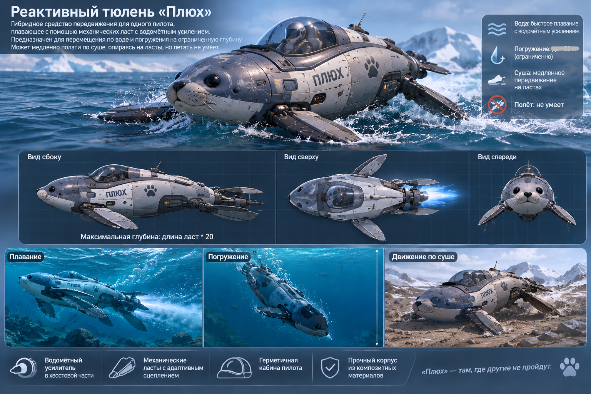

# Jet Seal
Автор: Ермолинская Юлия Олеговна (№6)  
Разработчик: Сорокин Святослав Алексеевич (№20)  
Реализация реактивного тюленя по требованиям из `SPEC.md`.



Реактивный тюлень «Плюх» — гибридное средство передвижения для одного
пилота, плавающее с помощью механических ласт с водомётным усилением.
Предназначен для перемещения по воде и погружения на ограниченную глубину.
Может медленно ползти по суше, опираясь на ласты, но летать не умеет.

## Запуск тестов

Требуется Python 3.10 или новее. Дополнительные зависимости не нужны.
Из корня репозитория выполните:

```bash
python -m unittest discover -s tests -t . -v
```

Запуск отдельного тестового модуля:

```bash
python -m unittest tests.test_scenarios -v
python -m unittest tests.test_jet_seal -v
```
